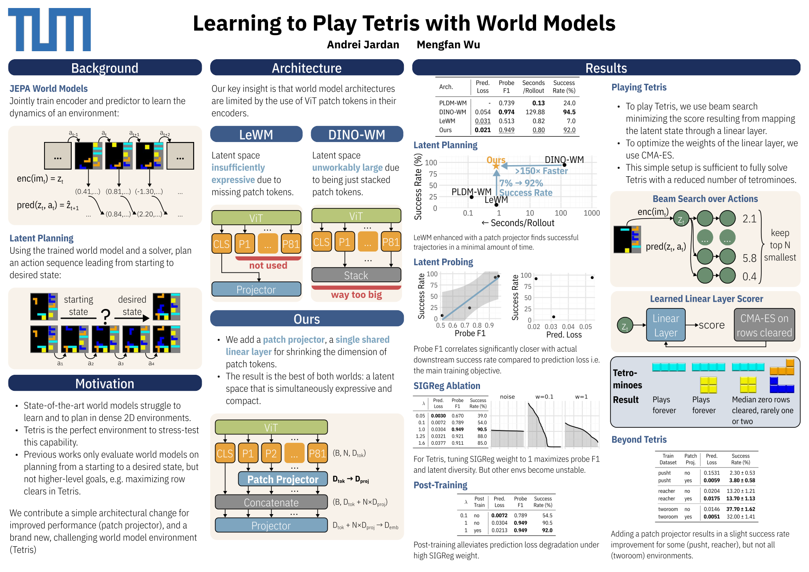
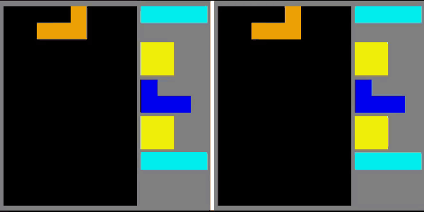
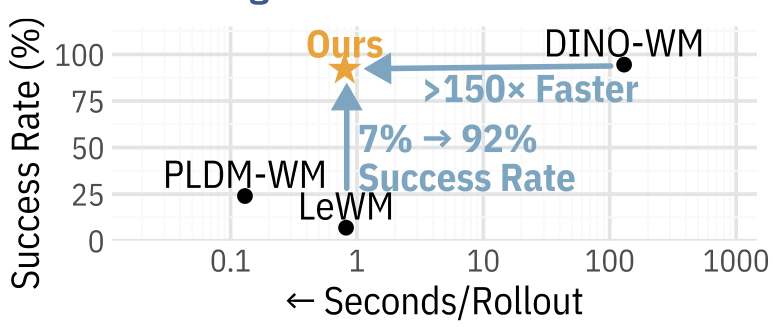

# Learning to Play Tetris with World Models

**Andrei Jardan · Mengfan Wu** — Technical University of Munich

[**Report**](docs/report.pdf) · [**Poster**](docs/poster.pdf) · [**Slides**](docs/slides.pdf)

<p align="center">
  
</p>

Joint-embedding predictive architectures (JEPAs) are good at planning in sparse
scenes — a few objects moving against a static background. We show that they
**fail on dense, discrete dynamics**: on Tetris, LeWM plans successfully in only
**7 %** of episodes. We trace this to how ViT tokens enter the latent state and
fix it with a one-layer change, the **patch projector**.

<p align="center">
  <br>
  <sub>Real game (left) vs. the world model's imagined rollout (right) on the {I, O, L, J} piece set.
  The grid probe overlays errors: <b>pink</b> = missing tile, <b>purple</b> = extra tile.
  <a href="docs/demo.mp4">Full-quality video</a>.</sub>
</p>

## Highlights

- **Patch projector** — a single linear layer, shared across all ViT patches,
  that shrinks each patch token before it is concatenated with the CLS token.
  LeWM (CLS only) and DINO-WM (all patches stacked) are the two endpoints of one
  design axis. Planning success on Tetris goes **7 % → 92 %** at the same
  rollout cost as LeWM, and **>150× faster** than DINO-WM.
- **Tetris as a world-model benchmark** — a configurable environment (grid size,
  tetromino subset, piece-queue length) with dense, discrete, non-local
  dynamics. Implemented from scratch, with a Gymnasium wrapper and a pygame UI.
- **Planning from a sparse reward, not a goal image** — a linear scorer over
  the latent, optimised with CMA-ES on rows cleared, turns the world model into
  a Tetris player that plays reduced Tetris indefinitely.
- **Latent grid probe** — a linear probe that decodes board occupancy from the
  latent. Its F1 predicts downstream planning success much better than
  prediction loss does, so it works as a cheap model-selection signal.
- Larger SIGReg weights (λ = 1, versus ≈0.1 in LeWM) become usable with the
  patch projector.

<p align="center">
  
</p>

| Architecture | Seconds / rollout | Probe F1 | Success rate (%) |
|--------------|------------------:|---------:|-----------------:|
| PLDM-WM      |              0.13 |    0.739 |             24.0 |
| DINO-WM      |            129.88 |    0.974 |             94.5 |
| LeWM         |              0.82 |    0.513 |              7.0 |
| **Ours**     |          **0.80** |    0.949 |         **92.0** |

Goal-reaching on 100 held-out Tetris episodes (8×12 board, tetrominoes {I, O, L, J}),
beam search with width 200 and horizon 5. Full ablations (patch-projector
dimension, SIGReg weight, post-training, other environments) are in the
[report](docs/report.pdf).

### Limitations

- The patch projector helps a lot on Tetris, but only slightly on PushT and
  Reacher, and hurts on TwoRoom. We did not tune hyperparameters for those.
- The Tetris player only solves reduced piece sets ({I}, {I, O}). With more
  piece types it breaks down. Likely causes: a single linear scorer is too weak,
  and the random-play dataset contains very few row clears (71 in total).

## The patch projector in code

The core change is in the encoder path of
[`lewm/jepa.py`](lewm/jepa.py) (`encode_pixels`) with the module construction in
[`lewm/train.py`](lewm/train.py). In essence:

```python
z = W_e( concat[ cls_token,  W_p(patch_1), ..., W_p(patch_N) ] )   # W_p: D_tok -> D_proj, shared
```

`D_proj = 0` recovers LeWM; `D_proj = D_tok` with `W_p = I` recovers DINO-WM.
The best setting for Tetris was `D_proj = 8` (`wm.patch_projector.dim=8`).

## Repository layout

| Path | What it is |
|------|-----------|
| `tetris/` | Tetris engine (`tetris.py`), Gymnasium env (`gym_env.py`), pygame player with side-by-side ground-truth vs. world-model rollouts (`play.py`) |
| `generate_trajectories.py`, `tetris_policy.py` | Dataset generation (random / heuristic / mixed policies) into HDF5 |
| `lewm/` | World models and training: LeWM + patch projector (`train.py`, `jepa.py`, `module.py`), DINO-WM and PLDM-WM baselines, probes, beam-search solver, CMA-ES scorer (`cmaes_tetris.py`), evaluation |
| `conf/` | Hydra configs — `conf/tetris/*.yaml` define datasets (piece sets, queue length, size); top-level files define training / eval runs |
| `dinowm/` | Vendored [DINO-WM](https://github.com/gaoyuezhou/dino_wm) code (MIT) used for the baseline |
| `docs/` | Report, poster and slides |

## Getting started

Environment: Docker with the provided `Dockerfile` / `docker-compose.yml`
(GPU or CPU profile). It installs a patched fork of
[stable-worldmodel](https://github.com/CyborgSquirrel/stable-worldmodel/tree/patched).

```bash
cp x.env.example x.env                       # fill in WANDB_KEY etc. (optional)
./setup_x11.py                               # only if you want the GUI
source x.env
docker compose --profile gpu build           # or --profile cpu
docker compose --profile gpu run --rm app-gpu bash
```

Everything below runs inside the container. Commands are Hydra entry points, so
any config value can be overridden on the command line.

**1. Play Tetris yourself** (arrows, space = hard drop, Z/X = rotate):

```bash
python -m tetris.play --scale 2 --gt --config conf/tetris/eval_iolj_100.yaml
```

Add `--wm --world-model <ckpt> --grid-probe <probe.pt>` to run a trained world
model next to the real game and compare their rollouts.

**2. Generate data**

```bash
python generate_trajectories.py --config-name train_iolj_25k   # conf/tetris/*.yaml
```

**3. Train a world model with the patch projector**

```bash
python lewm/train.py --config-name lewm_train_tetris tetris=train_iolj_25k \
    wm.patch_projector.enabled=true wm.patch_projector.dim=8 \
    wm.patch_projector.type=linear wm.patch_projector.weights=shared \
    loss.sigreg.weight=1.0
```

**4. Evaluate latent goal-reaching** (beam search)

```bash
python lewm/eval.py --config-name eval_tetris tetris=eval_100 policy=<run>/<checkpoint> \
    plan_config.horizon=5 plan_config.receding_horizon=1 \
    solver=beam_search solver.beam_width=200 \
    eval.goal_offset_steps=6 eval.eval_budget=5 solver.lazy=true
```

**5. Learn a row-clearing scorer with CMA-ES**

```bash
python lewm/cmaes_tetris.py tetris=train_iolj_25k checkpoint=<path to world model>
```

> These commands reflect the configs in `conf/`; checkpoint paths and some
> config names are specific to the original cluster runs.

## Acknowledgements

Built on [LeWorldModel](https://arxiv.org/abs/2603.19312) and
[stable-worldmodel](https://github.com/galilai-group/stable-worldmodel); baselines
from [DINO-WM](https://arxiv.org/abs/2411.04983) and
PLDM (Sobal et al., NeurIPS 2025). Project work done at the Technical
University of Munich.

## License

MIT, see [LICENSE](LICENSE). Vendored and derived code keeps its own license:
[`dinowm/`](dinowm/LICENSE) and [`lewm/`](lewm/LICENSE).
